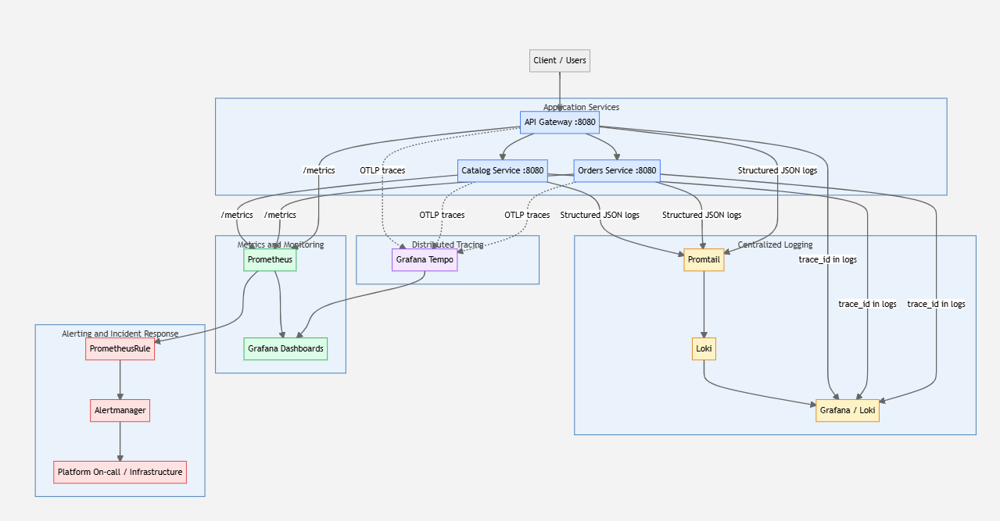
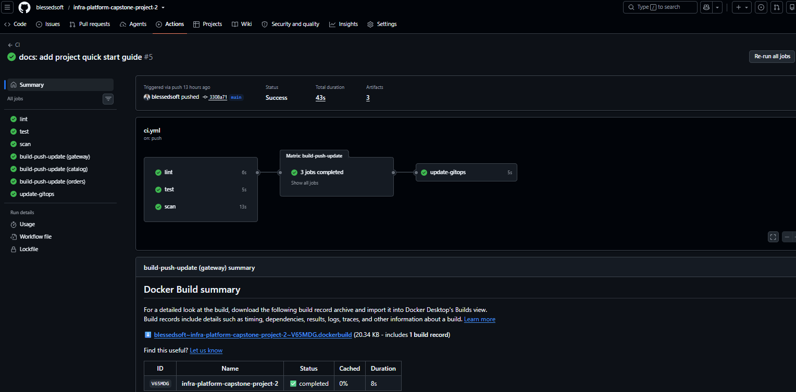
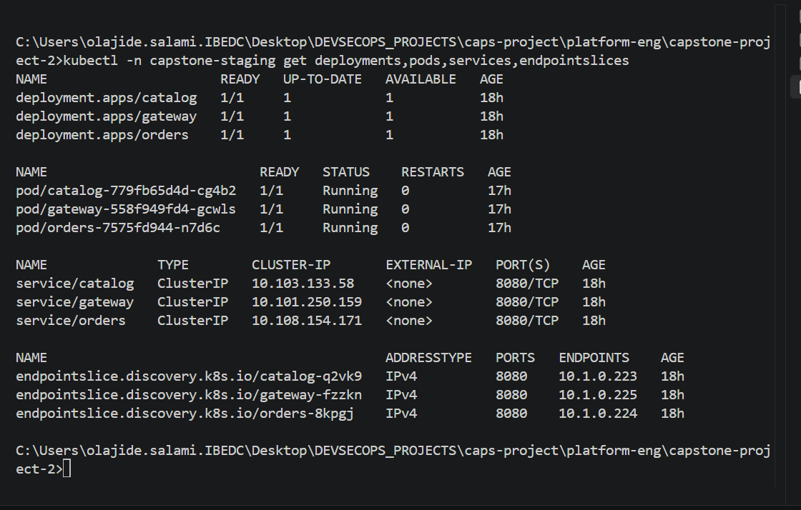
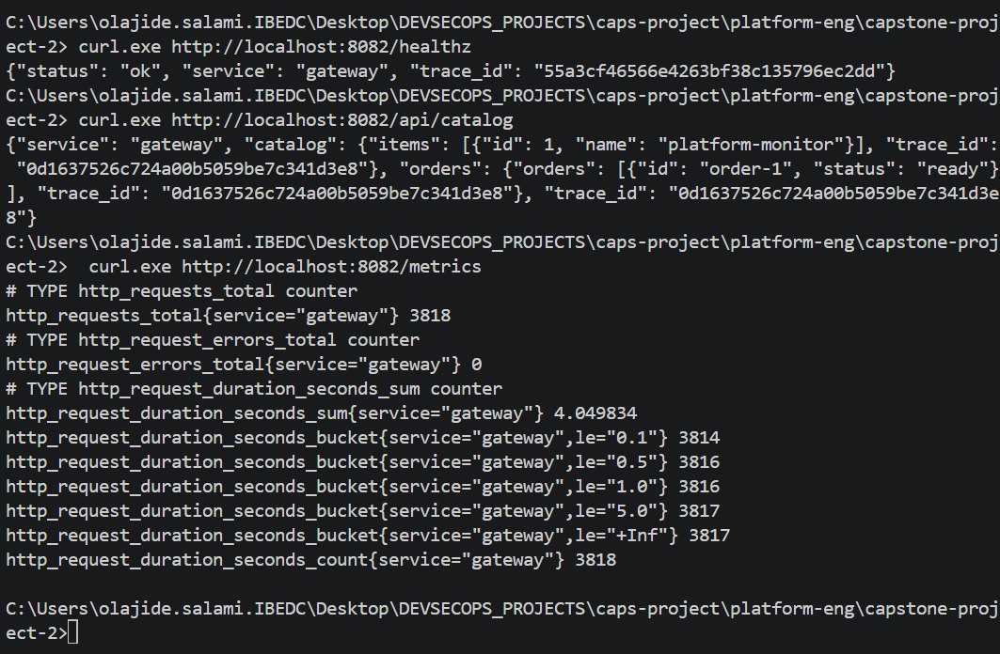
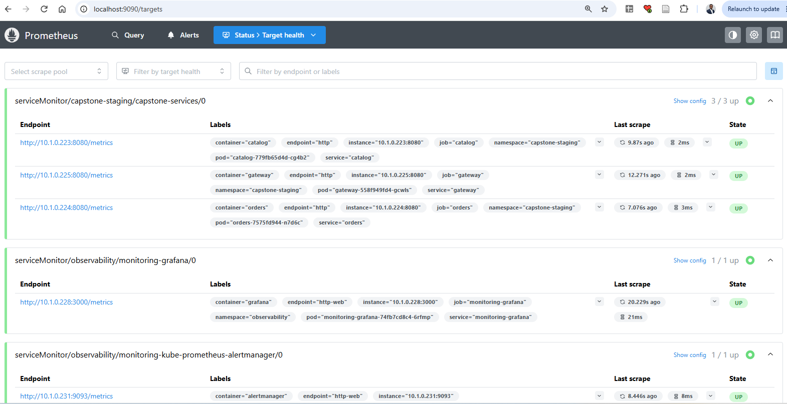
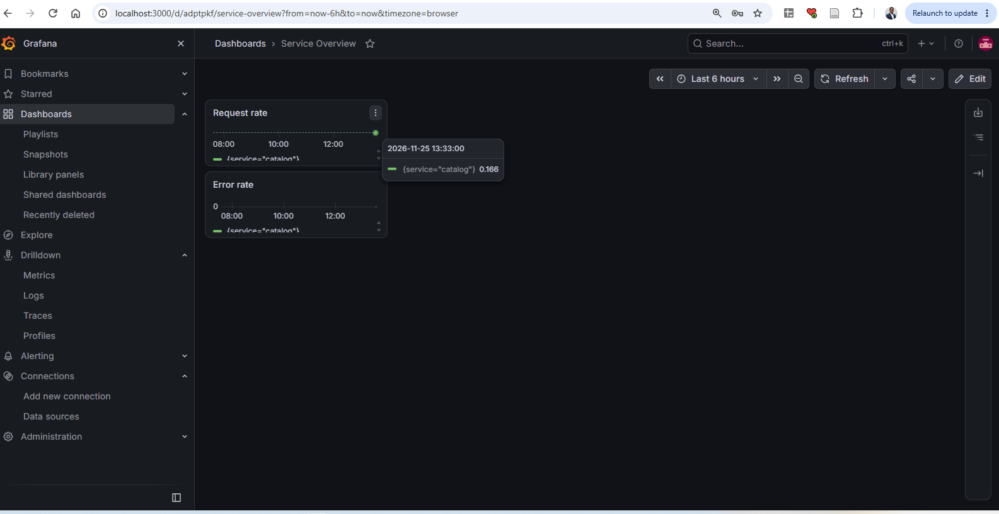
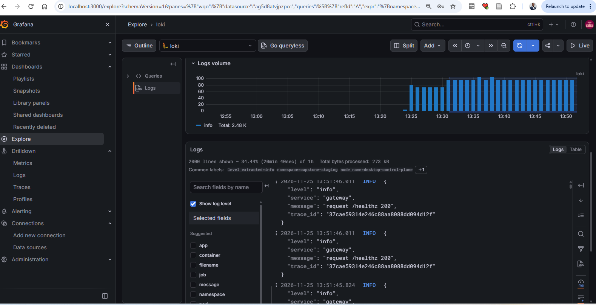
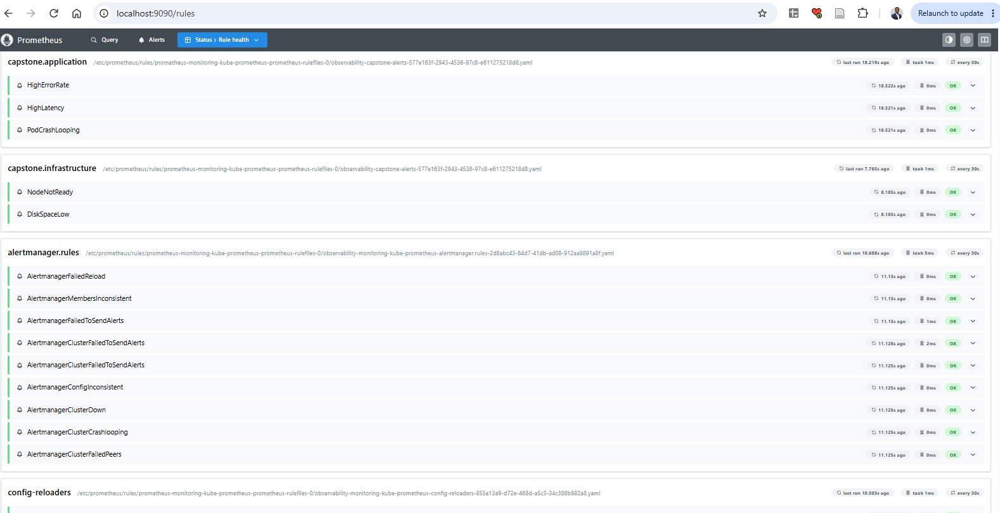
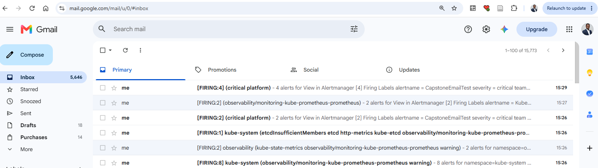
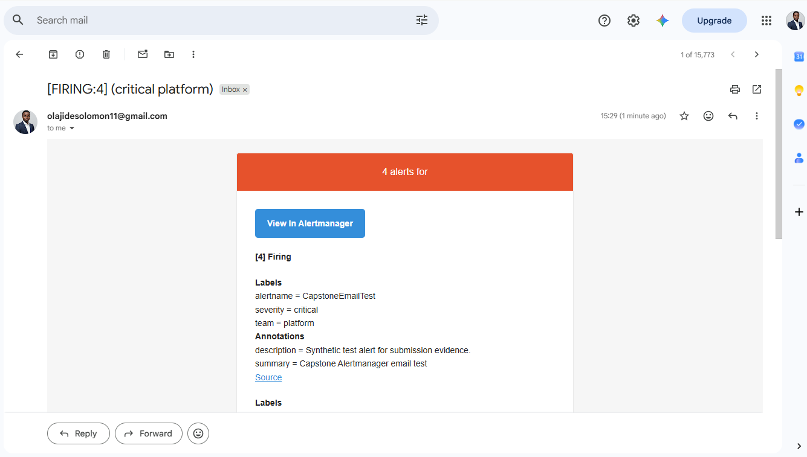

# GitOps Platform with Monitoring

This repository is a small, runnable reference implementation for the Capstone 2. It contains three Python services, a CI pipeline, Kubernetes GitOps manifests, and an observability baseline.

## Architecture




The gateway calls both backend services, so the deployment demonstrates service-to-service communication. All services expose `/healthz` and `/metrics` and emit JSON logs containing `trace_id`.

Architecture flow:
1. Application traffic: Client requests enter through the API Gateway and are routed to Catalog or Orders.
2. Metrics: Services expose /metrics; Prometheus scrapes them and Grafana visualizes the metrics.
3. Logging: Services emit structured JSON logs; Promtail collects and forwards them to Loki.
4. Tracing: Trace IDs correlate requests across service logs. Tempo receives distributed traces over OTLP.
5. Alerting: Prometheus evaluates rules, Alertmanager handles notifications, and alerts reach the platform/infrastructure on-call team.
Implementation note: Promtail has reached end of life. For a new deployment, consider Grafana Alloy as its replacement for collecting and forwarding logs and telemetry.

## Repository layout

```text
.
├── .github/
│   └── workflows/
│       └── ci.yml
├── app/
├── docs/
│   ├── quickstart.md
│   └── system-architecture.md
├── evidence/
├── gitops/
├── observability/
├── runbooks/
└── system-architecture.png
```


## Local run

From Windows Command Prompt:

```cmd
python -m unittest discover -s app -p 'test_*.py' -v
docker-compose up --build -d
curl.exe http://localhost:8080/healthz
curl.exe http://localhost:8080/api/catalog
curl.exe http://localhost:8080/metrics
```

If port `8080` is already occupied, keep catalog and orders running and expose the gateway on `8081`:

```cmd
docker-compose up --build -d catalog orders
docker-compose run --no-deps -d -p 8081:8080 gateway
curl.exe http://localhost:8081/healthz
```

For the complete Windows, Kubernetes, and observability walkthrough, see [`docs/quickstart.md`](docs/quickstart.md).

## CI and GitOps

Pushes to any branch run lint, unit tests, and a Trivy filesystem scan. A push to `main` builds and publishes the gateway, catalog, and orders images to GHCR, then updates the staging image tag in this repository using the GitHub Actions token.

The published image names are:

```text
ghcr.io/<github-owner>/capstone-gateway:<commit-sha>
ghcr.io/<github-owner>/capstone-catalog:<commit-sha>
ghcr.io/<github-owner>/capstone-orders:<commit-sha>
```

Staging is automated with prune and self-heal. Production has no automated sync policy and must be promoted explicitly in Argo CD. Reverting the image-tag commit in the GitOps repository rolls back staging automatically; production rolls back after its next manual sync.

```cmd
kubectl apply -f gitops/namespaces.yaml
kubectl apply -f gitops/argocd/staging.yaml
kubectl apply -f gitops/argocd/production.yaml
kubectl apply -k gitops/overlays/staging
```

See [`docs/deployment.md`](docs/deployment.md) for cluster setup, monitoring installation, drift, promotion, and rollback procedures. See [`docs/quickstart.md`](docs/quickstart.md) for the complete local run. No credentials are committed; GHCR, Grafana, and Alertmanager secrets are created out of band.

## Evidence


### 1. Successful GitHub Actions pipeline



### 2. Argo CD staging and production applications

Argo CD evidence still needs to be captured and added as `evidence/02-argocd-applications.png`.

### 3. Kubernetes services running





### 4. Prometheus targets showing UP



### 5. Grafana dashboard with live metrics



### 6. Loki logs containing trace IDs



### 7. Alert rules visible in Prometheus



### 8. Alertmanager notification routing



### 9. Gmail notification received


